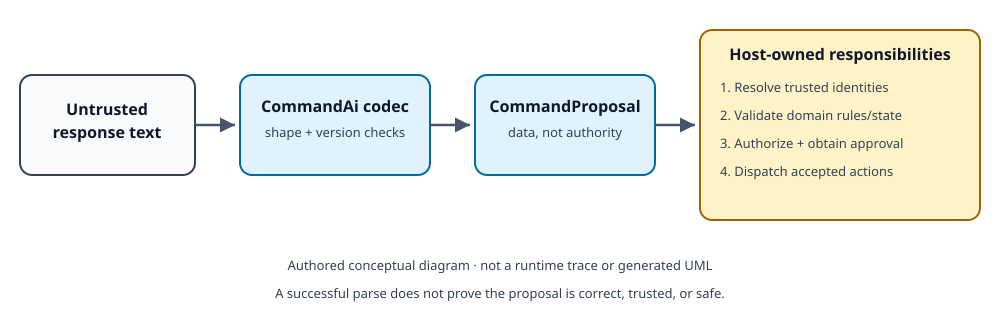

<!-- The Singularity Workshop moniker -->

# ✳️ 00 TheSingularityWorkshop.CommandAi

<em>A well-formed response is still only intent.</em>

## 01 What is CommandAi?

**CommandAi defines provider-neutral, immutable representations for application/AI exchanges.** Its compact proposal model carries ordered atomic actions and typed arguments. Its address-space model describes declared input/context slots and writable response slots, with local request/response correlation.

The protocol identity remains `CommandAi/1`. That identity is not the NuGet package version; internal contract evolution does not automatically require a version increment.

## 02 Why does it exist?

Applications need a bounded contract for exposing only the context and response shape they choose. CommandAi describes that boundary without owning application memory, operation meaning, policy, or execution.

## 03 How does it work?

An application declares descriptors with positive IDs, names, read/write access, value kinds, required-slot rules, and optional opaque GrammarAi definition metadata. It creates a `CommandExchange` with values for readable addresses. A model-facing layer can then produce a `CommandResponse` for writable addresses using the same exchange ID.

CommandAi rejects undeclared or duplicate addresses, invalid direction, missing required slots, mismatched value kinds, and response correlation mismatch. GrammarAi remains an independent owner of grammar validation; CommandAi has no GrammarAi dependency.

The compact proposal text codec continues to encode/decode `CommandProposal`. The address-space exchange model also has a canonical, deterministic JSON wire codec: `CommandExchangeTextCodec` encodes and decodes both exchanges and responses under `CommandAi/1`, with strict structural validation and bounded envelopes. The codec does not authorize or execute a response.

## 04 See it in a minute

~~~bash
dotnet run --project examples/CommandAi.QuickStart/CommandAi.QuickStart.csproj
~~~

The quickstart demonstrates the compact proposal API. The exchange and response model, including its JSON codec, is available as a separate API surface.

## 05 Documentation and theory

- [Documentation index](DOCUMENTATION_INDEX.md)
- [Problem domain](docs/PROBLEM_DOMAIN.md)
- [Domain completeness and ownership](docs/DOMAIN_COMPLETENESS.md)
- [Theory and wire contract](docs/THEORY.md)
- [Architecture](docs/ARCHITECTURE.md)
- [Usage guide](docs/USAGE.md)
- [Builder integration](docs/BUILDER_INTEGRATION.md)
- [Type guides](docs/types/)
- [UML and use cases](docs/UML/)
- [Status and verification](docs/REFLECTION.md)
- [Historical reference](docs/LEGACY_COMPATIBILITY.md)

## Package boundaries

| Package | Responsibility |
|---|---|
| ProtocolAi | Shared vocabulary identity and broader correlated event/outcome provenance |
| GrammarAi | Grammar definitions and structural validation |
| CommandAi | Immutable proposals, address descriptors, typed exchange values, correlation, bounds |
| HeadlessAi | Configured endpoint communication |
| CiAi | CI evidence, verdicts, and domain-specific mappings |
| AppAi (future) | Application-program composition and response planning |
| FSM_Foundry / host | Live-state checks, policy, authorization, approval, scheduling, dispatch, execution |

CommandAi has no runtime dependency on sibling packages. It does not dereference addresses, interpret application semantics, authorize, or execute.

## Verification and release status

The repository workflow restores, builds, tests, runs the quickstart, packs, and audits the package artifact. Package version remains `0.1.0-alpha.2`. NuGet publication remains disabled and requires explicit owner authorization.

---

<!-- THE SINGULARITY WORKSHOP FOOTER -->

