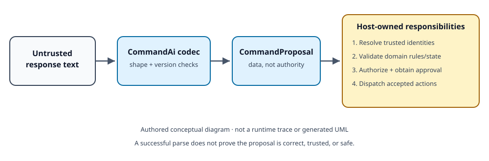

<!-- The Singularity Workshop moniker -->

# ✳️ 00 TheSingularityWorkshop.CommandAi

<em>A well-formed proposal is still only a proposal.</em>

## 🟦 01 What is CommandAi?

**CommandAi gives software a deterministic representation for commands proposed by an AI or another untrusted input source.** It models a versioned proposal as action identifiers and parameter/value pairs, with explicit support for integer identities and literal text.

CommandAi is not an autonomous agent and is not a command runner. It turns a representation into inspectable data; it does not turn that data into permission.

## 🟣 02 Why does it exist?

Free-form model output is hard for a host to validate reliably. A small, explicit envelope gives the host something it can parse, test, log, and reject deterministically. Integer identities keep known vocabulary separate from model-generated spelling; literal text remains visibly data.

The analogy is a shipping label: it helps identify what is being proposed, but it does not prove the contents are correct or authorize delivery.

## 🩵 03 How does it work?

    [CommandAi]
    Protocol=CommandAi/1
    Command=100 200=302 201="Logs.Diagnostic Stream"
    [/CommandAi]

- 100 is an opaque action identity.
- 200=302 pairs a parameter identity with an integer value identity.
- 201="Logs.Diagnostic Stream" pairs a parameter identity with literal text.

The integers are examples, not built-in meanings. The consuming host resolves identities against trusted vocabulary and applies its own domain rules.

## 🟢 04 See it in a minute

Run the local example:

    dotnet run --project examples/CommandAi.QuickStart/CommandAi.QuickStart.csproj

Or create a proposal in C#:

    using TheSingularityWorkshop.CommandAi;
    var proposal = new CommandProposal([new CommandInstruction(100, [
        new CommandArgument(200, CommandValue.FromIdentifier(302)),
        new CommandArgument(201, CommandValue.FromText("Logs.Diagnostic Stream"))
    ])]);
    var wireText = CommandAiTextCodec.Encode(proposal);
    var decoded = CommandAiTextCodec.Decode(wireText);
    Console.WriteLine(wireText);

This example is source-authored and awaits CI verification. It demonstrates representation and round-trip intent only—not vocabulary resolution, authorization, or execution.

## 🟪 05 Documentation and theory

- [AI series boundaries](docs/AI_SERIES.md) — responsibilities and trust boundaries across ProtocolAi, GrammarAi, CommandAi, and HeadlessAi.
- [Per-type documentation](docs/types/) and [UML/use cases](docs/UML/) — source-grounded public type contracts and consumer scenarios.
- [Usage guide](docs/USAGE.md) — construct, encode, decode, and verify a proposal.
- [Problem domain](docs/PROBLEM_DOMAIN.md) — purpose, non-goals, and acceptance criteria.
- [Theory](docs/THEORY.md) — why representation, identity, structure, and authority are separate.
- [Architecture](docs/ARCHITECTURE.md) — component boundary and failure behavior.
- [Gallery](docs/GALLERY.md) — the current reproducible example and what it proves.
- [Status and open questions](docs/REFLECTION.md) — implementation state and remaining evidence.
- [Shared documentation standard](https://github.com/TrentBest/TheSingularityWorkshop.FSM_COS/blob/master/DOCUMENTATION_STANDARD.md).

## Package boundary

| Package | Domain |
|---|---|
| [ProtocolAi](https://github.com/TrentBest/TheSingularityWorkshop.ProtocolAi) | Vocabulary and symbol identity |
| [GrammarAi](https://github.com/TrentBest/TheSingularityWorkshop.GrammarAi) | Legal structural composition |
| **CommandAi** | Versioned command proposals and representation |
| [HeadlessAi](https://github.com/TrentBest/TheSingularityWorkshop.HeadlessAi) | Configured AI endpoint communication |
| Host application | Trust, policy, approval, and execution |

This separation is an architectural intent; cross-package compatibility must be verified before claiming a complete end-to-end protocol. CommandAi has no runtime dependency on its siblings in this initial implementation.

## Verification and release status

The repository workflow restores, builds, tests, packs, and uploads an artifact for inspection. **NuGet publication is disabled** unless the owner explicitly authorizes a release. No package release is being performed by this work.

## Resources and support

- [Source repository](https://github.com/TrentBest/TheSingularityWorkshop.CommandAi)
- [The Singularity Workshop on GitHub](https://github.com/TrentBest)
- [CoderLegion](https://coderlegion.com/user/The+Singularity+Workshop)

