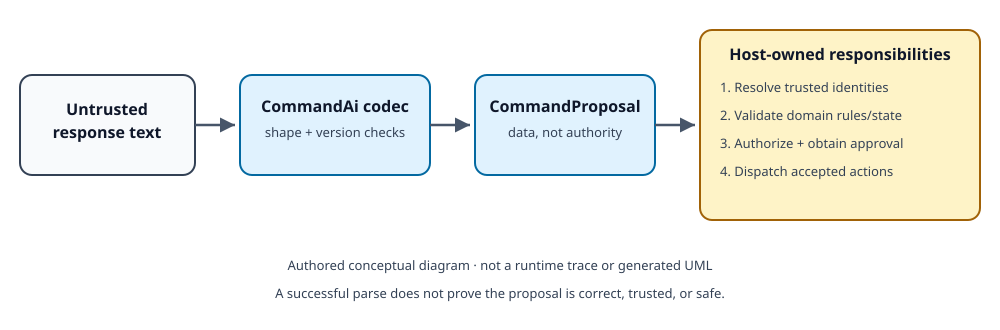

<!-- The Singularity Workshop moniker -->

# ✳️ 00 TheSingularityWorkshop.CommandAi

<em>A well-formed response is still only intent.</em>

## 01 What is CommandAi?

**CommandAi defines provider-neutral, immutable representations for application/AI exchanges.** Its CommandAi/1 proposal model supports the original compact Command entries and an additive enriched AtomicCommand representation. It also provides typed arguments, bounded opaque GrammarAi transport, and correlated address-space exchange/response representations. It describes intent; it does not authorize or execute it.

The protocol identity remains CommandAi/1. That identity is not the NuGet package version. The enriched entry is an additive extension for upgraded readers; compact-only readers must reject AtomicCommand entries rather than silently ignore or reinterpret them.

## 02 Why does it exist?

Applications need bounded contracts for exposing only the context and response shape they choose. CommandAi describes those boundaries without owning application memory, operation meaning, grammar interpretation, policy, or execution.

## 03 How does it work?

An application can declare address descriptors with positive IDs, names, read/write access, value kinds, required-slot rules, and optional opaque GrammarAi definition metadata. It creates a CommandExchange with values for readable addresses. A model-facing layer can then produce a CommandResponse for writable addresses using the same exchange ID. The exchange codec validates structure and correlation; it does not authorize or execute a response.

For proposals, compact Command entries retain the original action-and-arguments form. Enriched AtomicCommand entries add command identity, typed target and scope, a caller-supplied idempotency identity, opaque grammar-versioned preconditions, an expected-outcome shape, and an optional bounded GrammarAi body. Both forms can coexist in one ordered proposal. CommandAi validates representation, framing, and bounds only. GrammarAi owns grammar interpretation and structural validation; the trusted host owns live-state evaluation, policy, authorization, replay/deduplication enforcement, dispatch, and execution.

## 04 See it in a minute

~~~bash
dotnet run --project examples/CommandAi.QuickStart/CommandAi.QuickStart.csproj
~~~

The quickstart demonstrates the compact proposal API. The Usage guide documents the enriched builder and wire representation. The optional MicroBundle quickstart demonstrates the same codec capability through IMicroBundle.

## 05 Documentation and theory

- [Documentation index](DOCUMENTATION_INDEX.md)
- [Problem domain](docs/PROBLEM_DOMAIN.md)
- [Domain completeness and ownership](docs/DOMAIN_COMPLETENESS.md)
- [Theory and wire contract](docs/THEORY.md)
- [Architecture](docs/ARCHITECTURE.md)
- [SingularityBot integration concept](docs/SINGULARITYBOT_INTEGRATION.md)
- [Usage guide](docs/USAGE.md)
- [Builder integration](docs/BUILDER_INTEGRATION.md)
- [Type guides](docs/types/)
- [UML and use cases](docs/UML/)
- [Status and verification](docs/REFLECTION.md)
- [Historical reference](docs/LEGACY_COMPATIBILITY.md)

## Package boundaries

| Package | Responsibility |
|---|---|
| ProtocolAi | Shared vocabulary identity and broader correlated event/outcome provenance |
| GrammarAi | Grammar definitions and structural validation |
| CommandAi | Compact and enriched immutable proposals, exchange/response contracts, codecs, and bounds |
| CommandAi.MicroBundle (optional) | Exposes the CommandAi proposal codec as an IMicroBundle capability |
| HeadlessAi | Configured endpoint communication |
| CiAi | CI evidence, verdicts, and domain-specific mappings |
| AppAi (future) | Application-program composition and response planning |
| FSM_Foundry / host | Live-state checks, policy, authorization, approval, replay enforcement, scheduling, dispatch, execution |

The core TheSingularityWorkshop.CommandAi package remains dependency-free. Consumers that want MicroBundle composition can install TheSingularityWorkshop.CommandAi.MicroBundle; that adapter depends on the neutral MicroBundleDomain contract, not FSM_COS. Neither package resolves application semantics, authorizes, dispatches, or executes commands.

## Verification and release status

The repository workflow restores, builds, tests, runs both quickstarts, packs both packages, and audits each packed artifact with package-only consumers. The core package version remains 0.1.0-alpha.2; the optional adapter begins at 0.1.0-alpha.1. NuGet publication remains disabled and requires explicit owner authorization.

---

<!-- THE SINGULARITY WORKSHOP FOOTER -->

