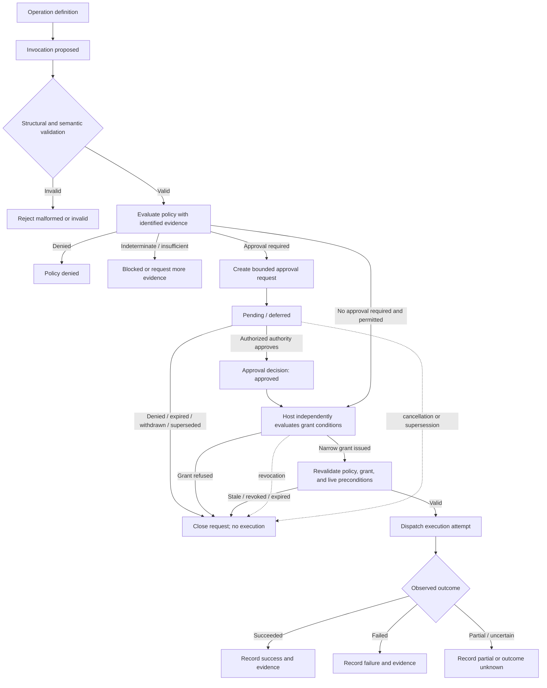

<!-- The Singularity Workshop moniker -->

# Governed command lifecycle — domain boundary investigation

**Status:** architecture investigation completed; no governance runtime or package is introduced by this document. The atomic proposal and exchange contracts remain unchanged. The lifecycle described here is a cross-domain model with current ownership assigned to the trusted host (Foundry), interoperable event representation assigned to ProtocolAi, and optional identity/disclosure context supplied by Profiles.

## 1. The central distinction

A command proposal expresses *what an issuer wants considered*. It does not establish *who the issuer is*, *whether the request is allowed*, *who may approve it*, *what information may be disclosed*, or *whether an operation may execute now*.

A governed command is therefore not one object with an `Authorized` Boolean. It is a sequence of separately owned facts and decisions:

- an application defines an operation and its meaning;
- an issuer submits one invocation/proposal;
- a policy evaluator assesses the invocation against a specific policy and evidence;
- an authority may decide whether an approval request is accepted or denied;
- the trusted host independently issues and enforces any execution capability;
- the host revalidates current conditions, dispatches an attempt, and records the actual outcome.

These stages can be asynchronous and may be handled by different principals and systems. Their identities, evidence, and state must not be collapsed into a mutable command DTO.

**Foundational invariant:** representation is not identity; identity is not authentication; disclosure is not authorization; evaluation is not approval; approval is not an execution capability; and a capability is not proof that execution succeeded.

## 2. Vocabulary and durable facts

| Concept | Meaning | Authority / persistence |
|---|---|---|
| Operation definition | Application-owned meaning, typed arguments, target semantics, and possible effects | Application/host definition registry; versioned independently |
| Invocation / proposal | One immutable request to invoke a defined operation with exact arguments and target | Issuer constructs; host assigns or validates stable invocation identity |
| Principal | Authenticated actor or service identity established by trusted infrastructure | Authentication authority; never inferred from a profile ID or caller field |
| Policy | Rules and decision procedure applicable to an invocation | Policy owner; identified by immutable policy identity/version |
| Policy evaluation | Evidence-bound assessment under one policy version | Identifies evaluator, policy version, input invocation digest, evidence references, result, uncertainty, and time |
| Authority | Principal or authority class allowed to make a particular decision | Trusted host configuration / delegation source |
| Approval request | A request for an authority to decide a bounded question about one invocation | Host-owned durable record with request identity, destination, scope, expiry, and disclosure policy |
| Approval decision | An authenticated authority's decision on that exact request | Host-owned durable record; immutable decision history |
| Authorization grant / capability | Host-issued permission for a precisely bounded operation | Host-owned, expiring and revocable; enforced at the operation boundary |
| Deferred invocation | An invocation awaiting evidence, policy resolution, or an approval decision | Host-owned lifecycle state; never executable merely because it is pending |
| Execution attempt | One dispatch/attempt after authorization and precondition revalidation | Trusted host/runtime record |
| Outcome and evidence | What actually happened, including partial or unknown results | Executing host and evidence providers; correlated to the exact attempt |

Policy evaluations, approval requests, decisions, grants, revocations, attempts, and outcomes are durable facts when they affect future authorization, audit, dispute resolution, or replay. In-memory work queues, notifications, evaluator scratch context, and presentation projections are transient. A transient notification must never become the authority for a durable state transition.

A decision may be recorded as immutable history while the current effective state is derived from that history plus expiry, revocation, policy changes, and live conditions. Do not overwrite a previous denial or approval to make the latest state appear simpler.

## 3. Lifecycle and state transitions

The diagram describes the conceptual lifecycle, not a new CommandAi state machine. Foundry owns authoritative state and transition enforcement.

Required semantic rules:

1. Structural validity is necessary but not sufficient. A syntactically valid proposal can still be semantically invalid or prohibited.
2. Policy evaluation is separate from approval. An evaluator returns an assessment; it is not the decision authority unless trusted policy explicitly delegates a narrowly scoped decision right.
3. Indeterminate, missing, stale, conflicting, or untrusted evidence is first-class. It must not silently become approval or success.
4. A pending approval request is not a grant, does not enter an executable queue by implication, and does not authorize automatic retry.
5. Approval is a decision on an exact request. It is not a transferable bearer token and does not itself authorize execution.
6. The host issues any capability only after checking authority, delegation, policy, exact invocation identity/digest, target, scope, arguments, intended executor, expiry, and applicable conditions.
7. Immediately before dispatch, the host revalidates current policy and live preconditions. A changed target, argument, scope, candidate, policy version, principal, or executor invalidates the prior grant unless the policy explicitly defines a safe rebind.
8. Revocation, expiry, withdrawal, supersession, cancellation, and stale state prevent new dispatch. An already-running side effect may require a separate cancellation/compensation protocol; revoking a grant does not magically undo completed work.
9. A terminal outcome describes observed execution, not the approval decision. Partial completion and unknown outcomes are not success.

## 4. Minimal cross-boundary contract

Do not embed policy documents, evidence archives, profile objects, credentials, or full audit history in every command. Pass bounded identities and references; retrieve content through separately authorized, size-limited host interfaces.

| Boundary | Minimum data crossing it | Must not be treated as |
|---|---|---|
| Issuer → host | Operation definition identity/version; invocation ID; exact proposal or immutable digest; target/scope; issuer assertion | Authentication proof or authorization |
| Authentication host → policy/authority resolver | Authenticated principal reference, authentication context/reference, trusted delegation context | A caller-supplied profile ID or group list |
| Host → evaluator | Invocation identity/digest; policy identity/version; evaluator identity; bounded evidence references/projections; disclosure policy | Permission to approve or execute |
| Evaluator → host | Evaluation ID; exact invocation digest; policy identity/version; evaluator identity; typed result (permit / deny / indeterminate / approval-required); evidence references/digests; timestamp | A capability or authoritative decision unless explicitly delegated |
| Host → approver | Approval request ID; exact invocation identity/digest; decision question and bounded scope; expiry; minimum-disclosure context; allowed decision choices | Full private profile or unrelated application state |
| Approver → host | Request ID; authenticated approver identity; decision; bounded conditions/scope; decision time; authority/delegation reference | A self-authenticating assertion or reusable global permission |
| Host → operation adapter | Opaque capability reference plus exact action/target/argument scope, executor binding, expiry and one-use/replay rules | Model-readable credential or broad repository/application token |
| Host ↔ ProtocolAi | Event/message ID; correlation/causation/idempotency IDs; asserted producer identity; event kind; occurrence time; typed payload and provenance references | Authentication, durable storage, delivery, deduplication, or permission |
| Execution adapter → host | Attempt ID; invocation/grant references; observed result; bounded evidence references; idempotency outcome | Approval or proof that unrelated work succeeded |

Neutral principal/authority/evaluator/executor references should be opaque and provider-neutral. Their resolution and trust come from the host. If Profiles is used, an adapter may map an already authenticated host principal to a permitted ProfileId and call `Profile.RepresentTo` for the specific observer. The adapter must project approved claims into bounded immutable/serialized evidence and preserve provenance and uncertainty. A host without Profiles supplies its own neutral references and disclosure mechanism.

## 5. Disclosure is an independent policy decision

At least three disclosure questions are distinct:

- May the issuer know that an approval request exists?
- May the issuer learn the decision outcome, and at what level of detail?
- May the issuer, evaluator, approver, or executor see the reason and underlying evidence?

A policy can permit an approver to see evidence while allowing the issuer only a generic pending or denied response. Request existence, decision reason, and source evidence can each have separate disclosure rules. Redaction must happen before data crosses the boundary; hiding a field in a UI is not a security control.

Profiles can help construct observer-specific information projections. Its `ProfileId` is not an authenticated principal; external identity bindings are mappings, not authentication; observer group IDs are trusted only when supplied by a trusted membership resolver; claim provenance and verification timestamps are metadata, not independent proof. `ProfileRepresentation` exposes a read-only copied claims collection but does not deep-clone arbitrary claim values. The host must protect the original Profile object and must not blindly serialize arbitrary claim objects.

Profiles' `IProfileAccessRecorder` concerns access to profile information. It does not replace the separate governance evidence for evaluations, approvals, grants, revocations, dispatch, and outcomes.

## 6. Threat model and trust boundaries

| Threat | Failure mode | Required control / adversarial test |
|---|---|---|
| Malicious issuer | Forges principal, target, scope, or approval | Authenticate independently; reject issuer self-approval without explicit trusted delegation |
| Compromised or prompt-injected evaluator | Claims approval, invents evidence, or follows hostile evidence instructions | Treat evaluator output and evidence as untrusted; evaluator cannot mint grants; test forged permit and malicious evidence |
| Confused deputy | Host executes a broader operation than the approved request | Bind grant to exact invocation digest, target, arguments, action, executor, and allowed scope; test altered target/arguments |
| Approver spoofing | Attacker claims an authority role or supplies a forged decision | Authenticate approver and resolve delegation from trusted host state; test forged and revoked delegation |
| Approval replay | Reuses an old decision or receipt | Bind decision to request, invocation, policy version, expiry, and unique consumption; test duplicate and concurrent replay |
| Scope broadening | Reuses approval for a wider target or more powerful arguments | Exact scope matching and deny-by-default; test superset scope and changed argument |
| Stale approval | Uses approval after policy, target, or live state changes | Revalidate immediately before dispatch; test policy-version and precondition drift |
| Revocation race | Grant is revoked while dispatch is being prepared | Serialize/check at the host enforcement boundary; test revocation before commit and define in-flight semantics |
| Disclosure leak | Reveals request existence, private evidence, profile claims, or approver identity | Separate disclosure policy and field allowlists; test each observer role and generic denial response |
| Profile identity confusion | Treats ProfileId/external mapping/group membership as proof of authentication or authority | Host-authenticated principal mapping; test untrusted IDs and groups cannot elevate rights |
| Event spoof/replay | Accepts asserted producer identity or replays old event as authority | Authenticate producer at host; durable inbox/digest/idempotency ledger; reject conflicting duplicate and stale causal revision |
| Journal split-brain/crash | Approval, grant, attempt, and lifecycle records disagree after crash | Durable transaction/outbox or explicit reconciliation; test crash between every persistence boundary |
| Partial/unknown side effect | Reports success after timeout, connection loss, or partial mutation | Typed outcome states; idempotent query/reconciliation; unknown is not success |

Trust boundaries are directional: issuer/model output is untrusted; evaluator output is untrusted unless a trusted policy delegates a defined decision; approver identity and delegation are established by authentication/authority infrastructure; capability issuance and enforcement are trusted-host responsibilities; operation adapters report observations but do not retroactively authorize themselves.

## 7. Package ownership and dependency decision

| Package / layer | Owns | Explicitly does not own |
|---|---|---|
| CommandAi | Immutable proposals, typed address-space exchange, structural validation, bounded serialization, local exchange correlation | Policy, principals, approval, disclosure, capabilities, persistence, dispatch, execution, workflow lifecycle |
| ProtocolAi | Shared identities and typed correlated event/provenance envelopes | Producer authentication, durable inbox/outbox, delivery, replay storage, authorization, execution |
| Profiles | Entity/profile semantics, claims, relationships, observer-specific disclosure projections, profile-access recorder seam | Authentication, command authorization, approval authority, execution grants, governance audit ledger |
| GrammarAi | Grammar definitions and deterministic structural validation | Business policy, identity, approval, authorization |
| HeadlessAi | Configured provider communication and normalized model turns | Trusting model output as authority or executing application commands |
| CiAi | CI evidence collection and verdict semantics | Human command approval or application execution |
| FSM_Foundry / trusted host | Authoritative task/run state, host policy orchestration, authenticated approval boundary, scoped capability issue/enforcement, revalidation, dispatch, execution attempts, outcomes, recovery | Universal identity provider or mandatory Profiles dependency |
| Application / observer layer | Human-facing command center, notifications, observer-specific response presentation | Authoritative permission decisions based only on presentation state |

**Decision: host-only orchestration for now.** The evidence does not justify a new governance package. Foundry already owns the operational lifecycle and host-issued scoped capabilities. ProtocolAi already provides the event envelope and provenance boundary. Profiles already provides optional observer disclosure. A new package today would either duplicate Foundry's authoritative state, duplicate ProtocolAi's event/correlation semantics, or redefine Profiles' identity/disclosure model.

A neutral policy/authority/approval contract package becomes justified only when a second independent host demonstrates actual reuse of the same policy identity/version, evaluator result, authority/delegation, approval request/decision, and disclosure contracts. If extracted later, it must be provider-neutral, have no mandatory Profiles dependency, and must not own execution state, credentials, persistence, or dispatch. It must not create a circular dependency with CommandAi, ProtocolAi, Profiles, or Foundry.

## 8. Current implementation evidence and limits

The current Foundry `development` documentation describes:

- versioned task requests and validated lifecycle transitions;
- fenced leases and append-only, fsync-backed local task, incident, and repair-attempt journals;
- host-issued, short-lived capabilities scoped to task/repository, agent and lease token, branch, base/candidate SHA, allowed paths, and named actions;
- expiry and revocation, with CODE RED mutation suspension and invalidation of earlier capabilities;
- a signed, single-use host-issued receipt required at the guarded CODE RED recovery transition;
- exact CI-attempt-bound repair decisions and a host notification interface.

The signed recovery receipt is a narrow proof from the host to Foundry that the authenticated host-side approval step occurred for one exact recovery transition. The host authenticates the person, applies approval policy, and issues it. It is not a general-purpose bearer capability, does not move approval authority into CommandAi, and does not justify a second approval-receipt system.

The documented persistence remains local/single-process. Separate task and repair-attempt journals are not one atomic transaction; the documentation notes that a crash between appends can leave an orphan attempt record requiring reconciliation. Cross-process lease arbitration, a distributed journal, and the fully composed CiAi ingress → exact artifact verification → HeadlessAi turn → repair loop → draft-PR handoff are not established merely by the local contracts.

ProtocolAi's v1 event envelope defines message, correlation, causation, idempotency, producer assertion, event kind, timestamp, and provenance fields, along with normative replay/causal-ordering rules. Its own documentation explicitly leaves producer authentication, evidence verification, durable inbox/outbox, at-rest deduplication, permission, and execution to the host. Its current v1 event vocabulary includes command accepted/rejected/completed outcomes but does not establish a complete policy/approval/grant ledger.

Profiles' README, privacy model, and API map explicitly distinguish disclosure from authentication, verification, licensing, and enforcement. The host protects the underlying Profile and owns trusted identity resolution and authorization.

Source references:
- [Foundry task lifecycle](https://github.com/TrentBest/TheSingularityWorkshop.FSM_Foundry/blob/development/docs/WORK_TASK_LIFECYCLE.md)
- [Foundry domain ownership](https://github.com/TrentBest/TheSingularityWorkshop.FSM_Foundry/blob/development/docs/DOMAIN.md)
- [Foundry Profiles host adapter boundary](https://github.com/TrentBest/TheSingularityWorkshop.FSM_Foundry/issues/4)
- [ProtocolAi event envelope v1](https://github.com/TrentBest/TheSingularityWorkshop.ProtocolAi/blob/development/docs/EVENT_ENVELOPES.md)
- [ProtocolAi integration evidence issue](https://github.com/TrentBest/TheSingularityWorkshop.ProtocolAi/issues/13)
- [Profiles privacy model](https://github.com/TrentBest/TheSingularityWorkshop.Profiles/blob/master/docs/PRIVACY.md)
- [Profiles API map](https://github.com/TrentBest/TheSingularityWorkshop.Profiles/blob/master/docs/API.md)

## 9. Adversarial acceptance tests and ownership gaps

The following are the minimum host-boundary tests before the governed lifecycle can be considered complete. They are requirements, not claims that all tests already exist.

| Invariant | Adversarial test | Owning layer |
|---|---|---|
| Issuer cannot self-approve by default | Issuer submits a matching approval decision without a delegated authority grant; request remains pending/rejected | Foundry host authorization |
| Evaluator is not authority by default | Evaluator returns Permit/Approved or a model asserts approval; no approval decision or capability is created | Foundry policy adapter |
| Deferred is not authorized | Pending request is presented to dispatch; dispatch is denied and no capability is issued | Foundry lifecycle/capability boundary |
| Approval cannot be replayed | Reuse same decision/request receipt concurrently and after consumption; exactly one valid consumption at most | Foundry host/core |
| Approval cannot be broadened | Change invocation digest, target, arguments, action, executor, or policy version; grant validation fails | Foundry capability boundary |
| Expired/revoked grant cannot execute | Expire or revoke between evaluation and dispatch; operation adapter rejects it | Foundry enforcement |
| Stale state is revalidated | Change live precondition or policy version after approval; dispatch is blocked pending reevaluation | Application/Foundry adapter |
| Disclosure is observer-specific | Issuer, evaluator, approver, executor, and auditor each receive only allowlisted fields; hidden request existence stays hidden | Host disclosure adapter; optional Profiles |
| Profiles cannot confer authority | Untrusted ProfileId/group/external identity binding or unverified claim cannot authenticate or approve | Profiles host adapter |
| Event identity is not authentication | Spoof producer field; reject at authenticated ingress despite valid envelope | ProtocolAi consumer host |
| Duplicate event is safe | Same message ID/digest is idempotent; same ID/different digest quarantined | Foundry durable inbox/outbox |
| Persistence recovers consistently | Inject crash between journal writes and reconcile without treating orphan records as committed authorization | Foundry persistence |

### Integration gap matrix

| Existing contract | Available boundary | Remaining proof |
|---|---|---|
| CommandAi issue #3 / CommandAi/1 | Atomic intent, typed arguments, bounded proposal and exchange serialization | Map proposal identity/digest to host task/attempt identity without adding governance fields to CommandAi |
| ProtocolAi issue #13 | Typed event envelope, correlation/causation/idempotency/provenance rules | Real host ingress, authentication, durable inbox/outbox, deduplication and causal replay |
| GrammarAi | Structural grammar validation | Confirm grammar validation is advisory structural input and cannot authorize an operation |
| Profiles | Optional observer-specific projection and access-record seam | Host authentication-to-ProfileId mapping, trusted observer groups, bounded immutable projection and paired Profiles-enabled/Profiles-free tests |
| FSM_Foundry | Local durable task/incident/attempt lifecycle, leases, host-issued scoped capabilities, guarded recovery proof | Adversarial authority/delegation and disclosure tests; crash reconciliation; cross-process persistence/leases; concrete transport and full vertical integration |
| HeadlessAi / CiAi | Bounded provider turns and CI evidence/verdict contracts | End-to-end evidence-to-turn-to-proposal binding with host enforcement; model output remains untrusted |

## 10. Change control

This investigation does not alter the approved CommandAi/1 wire or model contract, add a Profiles dependency, add a governance package, or change the NuGet package version. The compact proposal codec and exchange JSON codec remain separate representation surfaces.

No policy evaluation, approval UI, credential issuance, host execution, or workflow orchestration is to be implemented in CommandAi. Future changes must begin with a concrete owning consumer, explicit trust model, compatibility rule, bounds, adversarial tests, and evidence from the exact development commit.

No merge, master write, release, deployment, branch deletion, or NuGet publication is authorized by this investigation.

---

<!-- THE SINGULARITY WORKSHOP FOOTER -->

