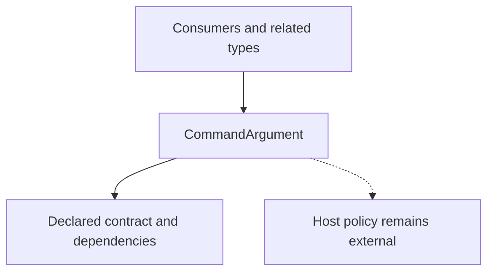

<!-- The Singularity Workshop moniker -->

# CommandArgument — UML neighborhood and use cases

> **Target:** public sealed record CommandArgument. The relationships below are authored from the current source and identify source-level structure; they are not runtime traces or generated UML.

## Neighborhood

### Source-supported relationships

- **Target source:** [CommandArgument.cs](../../CommandArgument.cs).
- **Related types and consumers:** CommandInstruction.cs; CommandAiTextCodec.cs.
- **Package reference:** CommandAi core targets .NET 8 and has no runtime project reference to ProtocolAi, GrammarAi, or HeadlessAi.
- **Provenance:** current C# declaration and repository references; no compiler-generated relationship inventory is claimed.

## Use cases

### UC-1 — Consume a proposed command safely

- **Actor:** host application.
- **Goal:** inspect a command proposal without confusing decoding with authorization.
- **Trigger:** the host receives a candidate CommandAi envelope.
- **Preconditions:** the host selects the expected CommandAi protocol version and trusted vocabulary.
- **Outcome:** a parsed representation is available for host-owned validation; no side effect occurs in CommandAi.
- **Failure/alternative:** malformed input or unsupported versions are rejected; the host logs/rejects the proposal rather than silently reinterpreting it.
- **Evidence/status:** source-authored use case grounded in the current codec and domain boundary; no automatic use-case inference is claimed.

### UC-2 — Inspect or encode a proposal in a test/example

- **Actor:** package consumer or test.
- **Goal:** create a deterministic representation and verify round-trip behavior.
- **Trigger:** a consumer constructs the typed model and calls the codec.
- **Outcome:** a versioned text envelope can be inspected or decoded.
- **Failure/alternative:** invalid IDs, duplicate parameters, empty proposals, or malformed literals are rejected.
- **Evidence/status:** source-checked against the quickstart and test suite; actual CI status is reported by the repository workflow.

## Detail levels

- **Collapsed:** CommandArgument and declaration kind.
- **Contract:** the public members and their argument/return types are defined by the source file.
- **Implementation:** see the source link above; this static Markdown page does not provide interactive expansion.

## Related pages

- [Type page](../types/CommandArgument.md)
- [Problem domain](../PROBLEM_DOMAIN.md)
- [Shared documentation standard](https://github.com/TrentBest/TheSingularityWorkshop.FSM_COS/blob/development/DOCUMENTATION_STANDARD.md)
