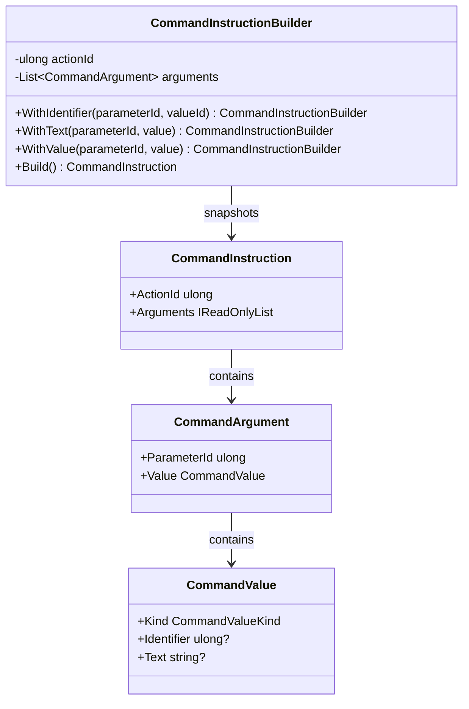

<!-- The Singularity Workshop moniker -->

# CommandInstructionBuilder — UML and use cases

## Class neighborhood

## Use case: add a typed argument

- Use `WithIdentifier(parameterId, valueId)` when the value is an opaque integer identity.
- Use `WithText(parameterId, value)` when the value is literal text.
- Use `WithValue(parameterId, value)` for an already constructed CommandValue.
- Build to validate and snapshot the ordered arguments.

## Boundary

The class does not know what an action or parameter ID means. It does not link ProtocolAi definitions, load GrammarAi, or execute a command.

---

<!-- THE SINGULARITY WORKSHOP FOOTER -->

