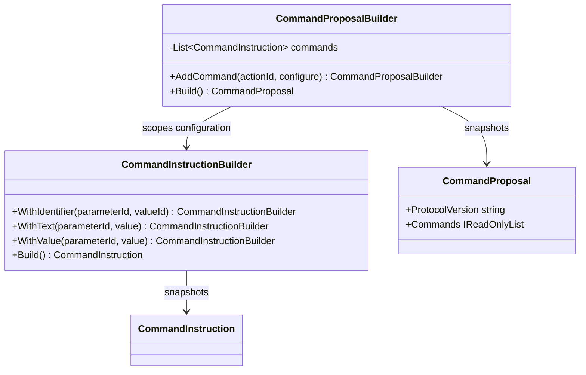

<!-- The Singularity Workshop moniker -->

# CommandProposalBuilder — UML and use cases

## Class neighborhood

## Use case: construct a proposal

1. Create a `CommandProposalBuilder`.
2. Add each opaque action identity in order.
3. Configure parameters using the scoped instruction builder.
4. Call `Build` to obtain a validated immutable proposal.
5. Encode with `CommandAiTextCodec` if a text representation is required.

## Boundary

The builder only constructs representation. The host still resolves IDs, validates current domain state, applies policy and authorization, obtains approval where required, and chooses whether to execute.

---

<!-- THE SINGULARITY WORKSHOP FOOTER -->

